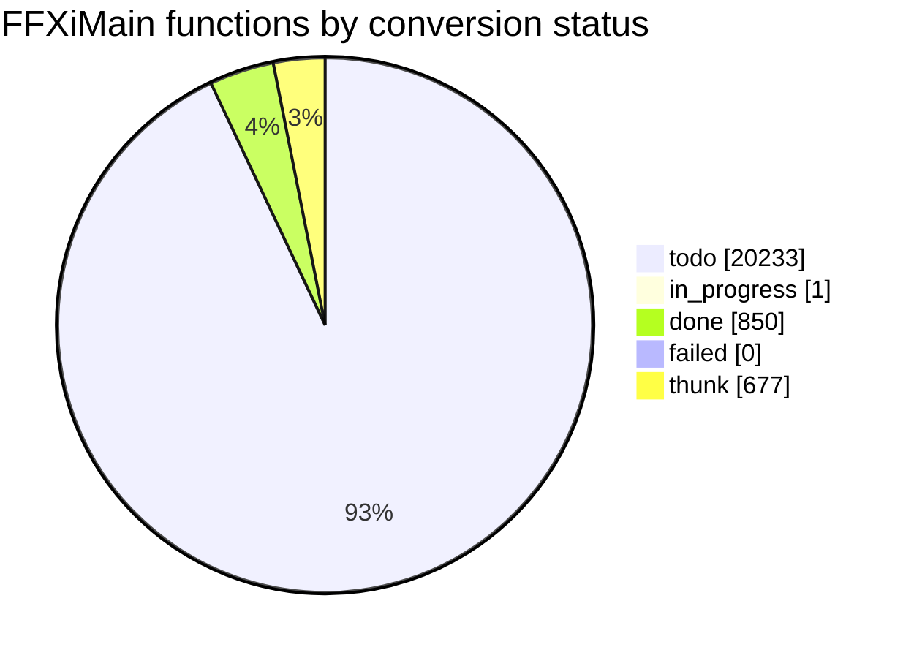

# Conversion status

<!-- Generated by tools/cow/status.py - do not edit by hand. Rerun: python tools/cow/status.py -->

- Last updated: 2026-11-04 19:22:14 UTC
- Commit being made: cow: 0x100a5640 cow_addr_unk_1032df68 [guess]
- Repo: `9cd540f6` on `main`, 15 uncommitted change(s) excluding this file's own outputs
- Inputs: ledger 21761 rows · names 1309 · loop.log 936 event(s) · unreached 0 unit(s)

## Progress

`done 850 of 21084 (4.0%) [#---------------------------]`

_Thunks (677) are excluded from the denominator: 5-byte `jmp rel32` stubs, not work._

## Status counts

## Progress by leaf_rank

Conversion runs leaves first: rank 0 calls no other FFXiMain function.

| leaf_rank | done | total | % |
| --- | --- | --- | --- |
| * **0** | 850 | 7133 | 11.9% |
| 1 | 0 | 2738 | 0.0% |
| 2 | 0 | 1353 | 0.0% |
| 3+ | 0 | 9860 | 0.0% |
| cycle | 0 | 118 | 0.0% |

_`cycle` is an overlay: a function in a call cycle also sits in one rank bucket._

## Last completed

| entry | name | file | verified | oracle evidence |
| --- | --- | --- | --- | --- |
| `0x10326afc` | cow_return_1 | src/unsorted/cow_10326afc_const.c | true | data reference .rdata 0x1034b460 function-pointer table - entered through a table slot, not a call |
| `0x10326a8d` | cow_return_1 | src/unsorted/cow_10326a8d_const.c | true | data reference .rdata 0x1034b454 function-pointer table - entered through a table slot, not a call |
| `0x10326877` | cow_vf0_at_1034b444 | src/unsorted/cow_10326877_const.c | true | vtable 0x1034b444 slot 0/2 - a virtual method |
| `0x1032675e` | cow_vf0_at_1034b434 | src/unsorted/cow_1032675e_const.c | true | vtable 0x1034b434 slot 0/2 - a virtual method |
| `0x10324be5` | cow_return_at_10324be5 | src/unsorted/cow_10324be5_zero.c | true | called from 2 code site(s): 0x1031fe73, 0x1032462a |
| `0x10323f5e` | cow_vf0_at_1034b2a0 | src/unsorted/cow_10323f5e_const.c | true | vtable 0x1034b2a0 slot 0/2 - a virtual method |
| `0x10322ba6` | cow_table_entry_at_10322ba6 | src/unsorted/cow_10322ba6_zero.c | true | data reference(s) in .data at 0x103d0744 - entered through a table or struct slot, not a call |
| `0x1031eefa` | cow_return_1 | src/unsorted/cow_1031eefa_const.c | true | vtable 0x1034a45c slot 0/2 - a virtual method |
| `0x10317e22` | cow_table_entry_at_10317e22 | src/unsorted/cow_10317e22_zero.c | true | data reference(s) in .data at 0x103d0738 - entered through a table or struct slot, not a call |
| `0x10311c20` | cow_vf1_at_103cffac | src/unsorted/cow_10311c20_ret.c | true | vtable 0x103cffac slot 1/3 - the address is a virtual method, not a noop |
| `0x10302913` | cow_return_at_10302913 | src/unsorted/cow_10302913_ret.c | true | called from 2 code site(s): 0x102f682e, 0x102f685d |
| `0x10302910` | cow_return_at_10302910 | src/unsorted/cow_10302910_zero.c | true | called from 1 code site(s): 0x102f6846 |
| `0x102e8fb7` | cow_vf42_at_10346468 | src/unsorted/cow_102e8fb7_zero.c | true | vtable 0x10346468 slot 42/43 - a virtual method |
| `0x102e8847` | cow_vf29_at_10346468 | src/unsorted/cow_102e8847_zero.c | true | vtable 0x10346468 slot 29/43 - a virtual method |
| `0x102e7ab7` | cow_vf20_at_10346468 | src/unsorted/cow_102e7ab7_zero.c | true | vtable 0x10346468 slot 20/43 - a virtual method |
| `0x102e1b6a` | cow_vf119_at_10346230 | src/unsorted/cow_102e1b6a_ret.c | true | vtable 0x10346230 slot 119/124 - the address is a virtual method, not a noop |
| `0x102e17af` | cow_vf2_at_10346140 | src/unsorted/cow_102e17af_ret.c | true | vtable 0x10346140 slot 2/8 - a virtual method |
| `0x102e17ac` | cow_vf1_at_10346140 | src/unsorted/cow_102e17ac_ret.c | true | vtable 0x10346140 slot 1/8 - a virtual method |
| `0x102d2a17` | cow_return_at_102d2a17 | src/unsorted/cow_102d2a17_self.c | true | called from 8 code site(s): 0x102d326f, 0x102d3935, 0x102d4f5c, 0x102dda82 |
| `0x102b2c90` | cow_return_at_102b2c90 | src/unsorted/cow_102b2c90_ret.c | true | called from 1 code site(s): 0x102b2c28 |

### The last five, as source

Read them; they are the standard every unit is held to.

- `0x10326afc` -> [cow_return_1](../../src/unsorted/cow_10326afc_const.c)
- `0x10326a8d` -> [cow_return_1](../../src/unsorted/cow_10326a8d_const.c)
- `0x10326877` -> [cow_vf0_at_1034b444](../../src/unsorted/cow_10326877_const.c)
- `0x1032675e` -> [cow_vf0_at_1034b434](../../src/unsorted/cow_1032675e_const.c)
- `0x10324be5` -> [cow_return_at_10324be5](../../src/unsorted/cow_10324be5_zero.c)

## Failed units

_None._

## Units with unreached blocks

_Every converted unit reached 100% of its generated basic blocks, or has no cowdiff yet._

## Names by confidence

| confidence | count |
| --- | --- |
| confirmed | 8 |
| guess | 543 |
| placeholder | 758 |

_The fix-up list is [docs/cow/NAMES_TODO.md](NAMES_TODO.md)._
