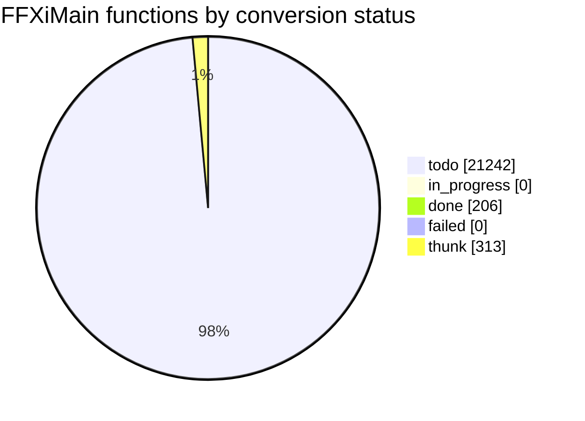

# Conversion status

<!-- Generated by tools/cow/status.py - do not edit by hand. Rerun: python tools/cow/status.py -->

- Last updated: 2026-11-03 15:21:45 UTC
- Commit being made: cow: 0x1014e630 unk_return_noop [placeholder]
- Repo: `00f35cb` on `main`, 8 uncommitted change(s) excluding this file's own outputs
- Inputs: ledger 21761 rows · names 218 · loop.log 207 event(s) · unreached 0 unit(s)

## Progress

`done 206 of 21448 (1.0%) [----------------------------]`

_Thunks (313) are excluded from the denominator: 5-byte `jmp rel32` stubs, not work._

## Status counts

## Progress by leaf_rank

Conversion runs leaves first: rank 0 calls no other FFXiMain function.

| leaf_rank | done | total | % |
| --- | --- | --- | --- |
| * **0** | 206 | 7497 | 2.7% |
| 1 | 0 | 2738 | 0.0% |
| 2 | 0 | 1353 | 0.0% |
| 3+ | 0 | 9860 | 0.0% |
| cycle | 0 | 118 | 0.0% |

_`cycle` is an overlay: a function in a call cycle also sits in one rank bucket._

## Last completed

| entry | name | file | verified |
| --- | --- | --- | --- |
| `0x1014e630` | unk_return_noop | src/unsorted/cow_1014e630_ret.c | true |
| `0x1014d3f0` | unk_return_noop | src/unsorted/cow_1014d3f0_ret.c | true |
| `0x1014c330` | unk_return_noop | src/unsorted/cow_1014c330_ret.c | true |
| `0x1014c250` | unk_return_noop | src/unsorted/cow_1014c250_ret.c | true |
| `0x1014a160` | unk_return_noop | src/unsorted/cow_1014a160_ret.c | true |
| `0x10145840` | unk_return_noop | src/unsorted/cow_10145840_ret.c | true |
| `0x10144050` | unk_return_noop | src/unsorted/cow_10144050_ret.c | true |
| `0x10143fb0` | unk_return_noop | src/unsorted/cow_10143fb0_ret.c | true |
| `0x10143f90` | unk_return_noop | src/unsorted/cow_10143f90_ret.c | true |
| `0x10143920` | unk_return_noop | src/unsorted/cow_10143920_ret.c | true |

## Failed units

_None._

## Units with unreached blocks

_Every converted unit reached 100% of its generated basic blocks, or has no cowdiff yet._

## Names by confidence

| confidence | count |
| --- | --- |
| confirmed | 5 |
| guess | 5 |
| placeholder | 208 |

_The fix-up list is [docs/cow/NAMES_TODO.md](NAMES_TODO.md)._
