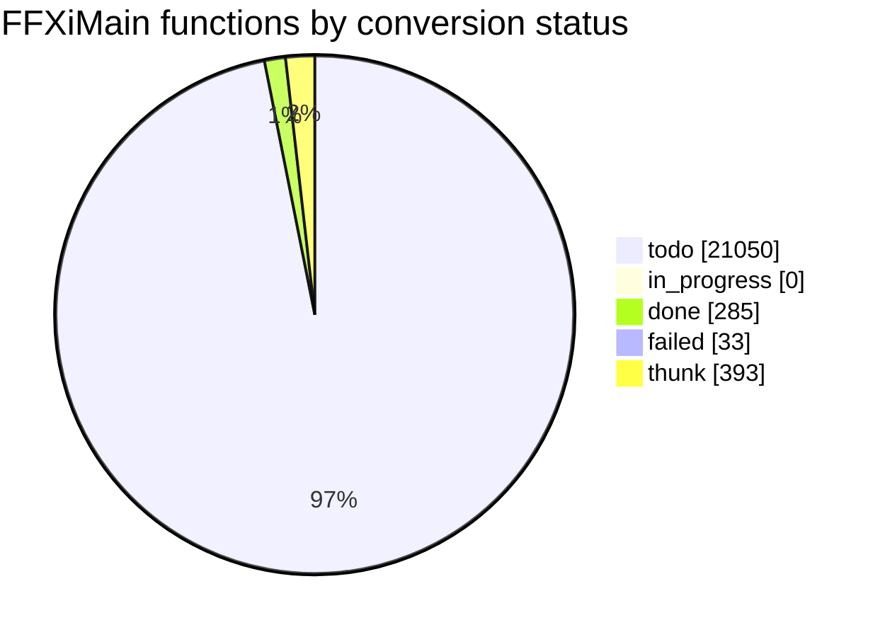

# Conversion status

<!-- Generated by tools/cow/status.py - do not edit by hand. Rerun: python tools/cow/status.py -->

- Last updated: 2026-11-04 02:05:40 UTC
- Commit being made: cow: 0x1000fda0 cow_return_zero [guess]
- Repo: `4da72dd` on `main`, 10 uncommitted change(s) excluding this file's own outputs
- Inputs: ledger 21761 rows · names 381 · loop.log 357 event(s) · unreached 0 unit(s)

## Progress

`done 285 of 21368 (1.3%) [----------------------------]`

_Thunks (393) are excluded from the denominator: 5-byte `jmp rel32` stubs, not work._

## Status counts

## Progress by leaf_rank

Conversion runs leaves first: rank 0 calls no other FFXiMain function.

| leaf_rank | done | total | % |
| --- | --- | --- | --- |
| * **0** | 285 | 7417 | 3.8% |
| 1 | 0 | 2738 | 0.0% |
| 2 | 0 | 1353 | 0.0% |
| 3+ | 0 | 9860 | 0.0% |
| cycle | 0 | 118 | 0.0% |

_`cycle` is an overlay: a function in a call cycle also sits in one rank bucket._

## Last completed

| entry | name | file | verified | oracle evidence |
| --- | --- | --- | --- | --- |
| `0x10311c20` | cow_vf1_at_103cffac | src/unsorted/cow_10311c20_ret.c | true | vtable 0x103cffac slot 1/3 - a virtual method |
| `0x10302913` | cow_return_at_10302913 | src/unsorted/cow_10302913_ret.c | true | called from 2 code site(s): 0x102f682e, 0x102f685d |
| `0x102e1b6a` | cow_vf119_at_10346230 | src/unsorted/cow_102e1b6a_ret.c | true | vtable 0x10346230 slot 119/124 - a virtual method |
| `0x102b2c90` | cow_return_at_102b2c90 | src/unsorted/cow_102b2c90_ret.c | true | called from 1 code site(s): 0x102b2c28 |
| `0x102b2a90` | cow_return_at_102b2a90 | src/unsorted/cow_102b2a90_ret.c | true | called from 1 code site(s): 0x102b2a08 |
| `0x102ac040` | cow_return_at_102ac040 | src/unsorted/cow_102ac040_ret.c | true | called from 3 code site(s): 0x102ac028, 0x102ac110, 0x102ac258 |
| `0x102a3400` | cow_return_at_102a3400 | src/unsorted/cow_102a3400_ret.c | true | called from 1 code site(s): 0x102a3388 |
| `0x1029bb70` | cow_return_at_1029bb70 | src/unsorted/cow_1029bb70_ret.c | true | called from 1 code site(s): 0x102a216f |
| `0x1029b4a0` | cow_return_at_1029b4a0 | src/unsorted/cow_1029b4a0_ret.c | true | called from 1 code site(s): 0x1029b478 |
| `0x1029b450` | cow_return_at_1029b450 | src/unsorted/cow_1029b450_ret.c | true | called from 1 code site(s): 0x1029b444 |
| `0x10299920` | cow_return_at_10299920 | src/unsorted/cow_10299920_ret.c | true | called from 1 code site(s): 0x102998f8 |
| `0x10298fb0` | cow_return_at_10298fb0 | src/unsorted/cow_10298fb0_ret.c | true | called from 1 code site(s): 0x10298f08 |
| `0x10295f40` | cow_return_at_10295f40 | src/unsorted/cow_10295f40_ret.c | true | called from 1 code site(s): 0x10295f18 |
| `0x10291c70` | cow_return_at_10291c70 | src/unsorted/cow_10291c70_ret.c | true | called from 2 code site(s): 0x1027c512, 0x10291c48 |
| `0x10291480` | cow_return_at_10291480 | src/unsorted/cow_10291480_ret.c | true | called from 2 code site(s): 0x1027c51d, 0x10291458 |
| `0x10291180` | cow_return_at_10291180 | src/unsorted/cow_10291180_ret.c | true | called from 1 code site(s): 0x10291108 |
| `0x10290a20` | cow_return_at_10290a20 | src/unsorted/cow_10290a20_ret.c | true | called from 1 code site(s): 0x10290908 |
| `0x10290450` | cow_return_at_10290450 | src/unsorted/cow_10290450_ret.c | true | called from 2 code site(s): 0x1028fca0, 0x1028fcd8 |
| `0x1028a000` | cow_return_at_1028a000 | src/unsorted/cow_1028a000_ret.c | true | called from 1 code site(s): 0x10289fd8 |
| `0x10284ed0` | cow_return_at_10284ed0 | src/unsorted/cow_10284ed0_ret.c | true | called from 1 code site(s): 0x10284bc9 |

### The last five, as source

Read them; they are the standard every unit is held to.

- `0x10311c20` -> [cow_vf1_at_103cffac](../../src/unsorted/cow_10311c20_ret.c)
- `0x10302913` -> [cow_return_at_10302913](../../src/unsorted/cow_10302913_ret.c)
- `0x102e1b6a` -> [cow_vf119_at_10346230](../../src/unsorted/cow_102e1b6a_ret.c)
- `0x102b2c90` -> [cow_return_at_102b2c90](../../src/unsorted/cow_102b2c90_ret.c)
- `0x102b2a90` -> [cow_return_at_102b2a90](../../src/unsorted/cow_102b2a90_ret.c)

## Failed units

| entry | name | reason |
| --- | --- | --- |
| `0x101b5a70` | - | unbooked: no vtable slot and no caller - a stub, not read |
| `0x10211eb0` | - | unproven: no vtable slot and no call/jmp/push reaches it - a stub, not read |
| `0x10211ef0` | - | unproven: no vtable slot and no call/jmp/push reaches it - a stub, not read |
| `0x10212040` | - | unproven: no vtable slot and no call/jmp/push reaches it - a stub, not read |
| `0x10212a90` | - | unproven: no vtable slot and no call/jmp/push reaches it - a stub, not read |
| `0x1021ad40` | - | unproven: no vtable slot and no call/jmp/push reaches it - a stub, not read |
| `0x102281b0` | - | unproven: no vtable slot and no call/jmp/push reaches it - a stub, not read |
| `0x10229550` | - | unproven: no vtable slot and no call/jmp/push reaches it - a stub, not read |
| `0x102302d0` | - | unproven: no vtable slot and no call/jmp/push reaches it - a stub, not read |
| `0x102421d0` | - | unproven: no vtable slot and no call/jmp/push reaches it - a stub, not read |
| `0x10245610` | - | unproven: no vtable slot and no call/jmp/push reaches it - a stub, not read |
| `0x10253700` | - | unproven: no vtable slot and no call/jmp/push reaches it - a stub, not read |
| `0x10253710` | - | unproven: no vtable slot and no call/jmp/push reaches it - a stub, not read |
| `0x10257550` | - | unproven: no vtable slot and no call/jmp/push reaches it - a stub, not read |
| `0x10257560` | - | unproven: no vtable slot and no call/jmp/push reaches it - a stub, not read |
| `0x10257e20` | - | unproven: no vtable slot and no call/jmp/push reaches it - a stub, not read |
| `0x1025e050` | - | unproven: no vtable slot and no call/jmp/push reaches it - a stub, not read |
| `0x1026e740` | - | unproven: no vtable slot and no call/jmp/push reaches it - a stub, not read |
| `0x1026fbb0` | - | unproven: no vtable slot and no call/jmp/push reaches it - a stub, not read |
| `0x1026fbc0` | - | unproven: no vtable slot and no call/jmp/push reaches it - a stub, not read |
| `0x102751d0` | - | unproven: no vtable slot and no call/jmp/push reaches it - a stub, not read |
| `0x102751e0` | - | unproven: no vtable slot and no call/jmp/push reaches it - a stub, not read |
| `0x1027dd80` | - | unproven: no vtable slot and no call/jmp/push reaches it - a stub, not read |
| `0x10282590` | - | unproven: no vtable slot and no call/jmp/push reaches it - a stub, not read |
| `0x10282920` | - | unproven: no vtable slot and no call/jmp/push reaches it - a stub, not read |
| `0x10282a40` | - | unproven: no vtable slot and no call/jmp/push reaches it - a stub, not read |
| `0x10282cc0` | - | unproven: no vtable slot and no call/jmp/push reaches it - a stub, not read |
| `0x10283b60` | - | unproven: no vtable slot and no call/jmp/push reaches it - a stub, not read |
| `0x10283f60` | - | unproven: no vtable slot and no call/jmp/push reaches it - a stub, not read |
| `0x10284f00` | - | unproven: no vtable slot and no call/jmp/push reaches it - a stub, not read |
| `0x1028a0c0` | - | unproven: no vtable slot and no call/jmp/push reaches it - a stub, not read |
| `0x1028bd20` | - | unproven: no vtable slot and no call/jmp/push reaches it - a stub, not read |
| `0x1028d750` | - | unproven: no vtable slot and no call/jmp/push reaches it - a stub, not read |

## Units with unreached blocks

_Every converted unit reached 100% of its generated basic blocks, or has no cowdiff yet._

## Names by confidence

| confidence | count |
| --- | --- |
| confirmed | 7 |
| guess | 29 |
| placeholder | 345 |

_The fix-up list is [docs/cow/NAMES_TODO.md](NAMES_TODO.md)._
