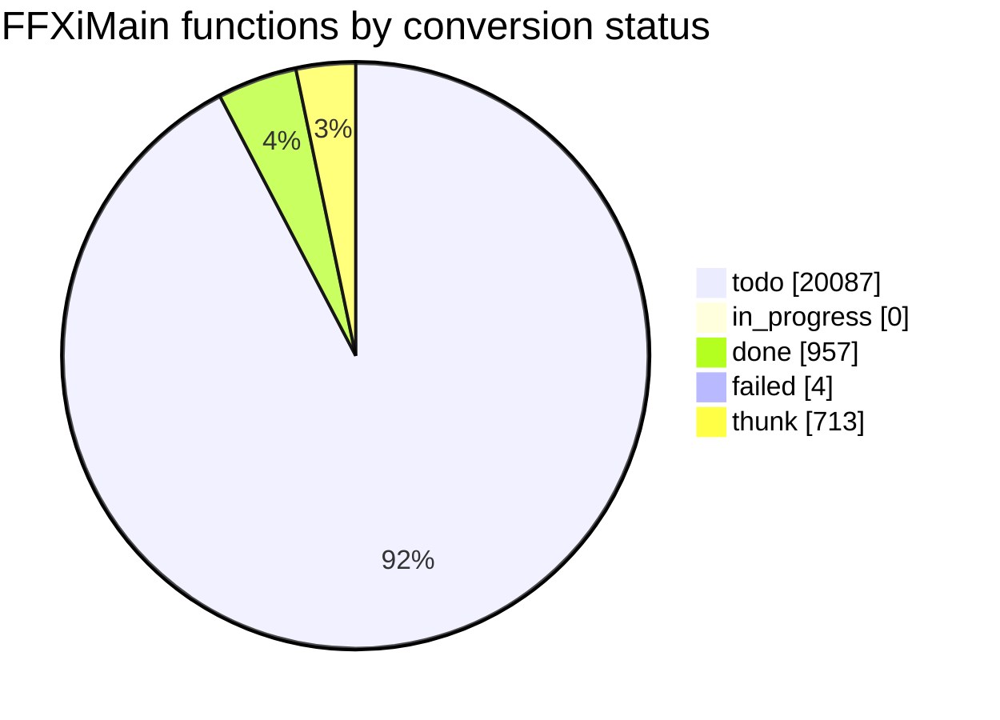

# Conversion status

<!-- Generated by tools/cow/status.py - do not edit by hand. Rerun: python tools/cow/status.py -->

- Last updated: 2026-11-05 13:12:49 UTC
- Commit being made: cow: unit - released 0x102d920a cubic split to todo (chain enters unconverted evaluator cluster)
- Repo: `daf4c575` on `main`, 0 uncommitted change(s) excluding this file's own outputs
- Inputs: ledger 21761 rows · names 624 · loop.log 1103 event(s) · unreached 1 unit(s)

## Progress

`done 14 of 19190 (0.1%) [----------------------------]`

_Thunks (713) are excluded from the denominator: 5-byte `jmp rel32` stubs, not work._

## Status counts

## Progress by leaf_rank

Conversion runs leaves first: rank 0 calls no other FFXiMain function.

| leaf_rank | done | total | % |
| --- | --- | --- | --- |
| * **0** | 13 | 5542 | 0.2% |
| 1 | 0 | 2637 | 0.0% |
| 2 | 0 | 1330 | 0.0% |
| 3+ | 1 | 9681 | 0.0% |
| cycle | 0 | 116 | 0.0% |

_`cycle` is an overlay: a function in a call cycle also sits in one rank bucket._

## Last completed

| entry | name | file | verified | oracle evidence |
| --- | --- | --- | --- | --- |
| `0x103165a8` | cow_seh_unwind_to_frame | src/util/cow_103165a8_seh_unwind.c | true | generated/all/funcs_052.c:43246; called from 2 code site(s): 0x103161bb, 0x1031d106 (tools/cow/callers_of.py)  |
| `0x103162e8` | cow_seh_unwind_and_clear_record | src/util/cow_103162e8_seh_unwind_and_clear_record.c | true | cow/seeds/103162e8.json: 4 states + 300 fuzz, 30/30 blocks |
| `0x101b41f0` | cow_ime_conversion_bit0_not_bit8 | src/ui/cow_101b41f0_ime_conversion_bit0_not_bit8.c | true | cow/seeds/101b41f0.json: 5 states + 300 fuzz, 41/41 blocks |
| `0x101b41a0` | cow_ime_is_open | src/ui/cow_101b41a0_ime_is_open.c | true | called from 2 code site(s): 0x101b3d2b, 0x101b3e2b (tools/cow/callers_of.py); callees named by tools/cow/iat_s |
| `0x101b4140` | cow_ime_conversion_bit1 | src/ui/cow_101b4140_ime_conversion_bit1.c | true | cow/seeds/101b4140.json: 5 states + 300 fuzz, 33/33 blocks |
| `0x101b40d0` | cow_ime_sentence_pending | src/ui/cow_101b40d0_ime_sentence_pending.c | true | cow/seeds/101b40d0.json: 5 states + 300 fuzz, 38/38 blocks |
| `0x101b3f70` | cow_ime_query_composition | src/ui/cow_101b3f70_ime_has_composition.c | true | called from 1 code site: 0x101b3056 (tools/cow/callers_of.py); callees named by tools/cow/iat_slot.py on slots |
| `0x1015ee40` | cow_ui_open_main_menu | src/ui/cow_1015ee40_open_main_menu.c | true | called from 0x1012be2f (mov ecx,0x10621838 / call 0x1015ee40); gates on [0x1057876c]+0x68/+0x59/+0xc4; the mod |
| `0x100dc210` | cow_advance_net_clock_tick | src/net/cow_100dc210_advance_net_clock_tick.c | true | generated/all/funcs_014.c (f_100dbeb0's call at 0x100dbeef, tools/cow/callers_of.py); winmm!timeGetTime thunk  |
| `0x100dc1f0` | cow_stamp_net_clock_tick | src/net/cow_100dc1f0_stamp_net_clock_tick.c | true | generated/all/funcs_014.c:19789; called from 0x100dbe98 (vtable_model); the global is upstream's frame_net_clo |
| `0x100dc040` | cow_net_clock_ms_since_frame | src/net/cow_100dc040_net_clock_ms_since_frame.c | true | called from 2 code site(s): 0x10085c03, 0x10085c53 (tools/cow/callers_of.py); field +0x08 proved by the store  |
| `0x100dbfe0` | cow_net_clock_record_sample | src/net/cow_100dbfe0_net_clock_record_sample.c | true | called from 5 code site(s): 0x100fa289, 0x100fa30f, 0x100fa4c1, 0x100fa55e, 0x100fcae7 (tools/cow/callers_of.p |
| `0x100dbf00` | cow_clock_window_delta | src/net/cow_100dbf00_clock_window_delta.c | true | called from 2 code site(s): 0x100dbec7 (f_100dbeb0) and 0x100dbf35 (f_100dbf20), both of which clean the 3 cde |
| `0x100083b0` | cow_incr_counter_if_active | src/unsorted/cow_100083b0_counted.c | true | generated/all/funcs_000.c:55114 |

### The last five, as source

Read them; they are the standard every unit is held to.

- `0x103165a8` -> [cow_seh_unwind_to_frame](../../src/util/cow_103165a8_seh_unwind.c)
- `0x103162e8` -> [cow_seh_unwind_and_clear_record](../../src/util/cow_103162e8_seh_unwind_and_clear_record.c)
- `0x101b41f0` -> [cow_ime_conversion_bit0_not_bit8](../../src/ui/cow_101b41f0_ime_conversion_bit0_not_bit8.c)
- `0x101b41a0` -> [cow_ime_is_open](../../src/ui/cow_101b41a0_ime_is_open.c)
- `0x101b4140` -> [cow_ime_conversion_bit1](../../src/ui/cow_101b4140_ime_conversion_bit1.c)

## Trivial shapes (the table)

**trivial (tabled): 943 row(s)** in `src/tables/` - entries whose whole body is one or two instructions (a bare `ret`, a getter, a constant). One shared runner, one row each, 943 proven by cowdiff in `cow/table_proof.json`. Not counted as converted, the way thunks are not.

**trivial (awaiting a row): 915** more entries the meta calls <=8 bytes, still `todo`: same kind of shape, not yet classified by `tools/cow/mktable.py`. Kept out of the 19,190 so the denominator is only functions with logic; listed here so they stay visible.

| shape | rows |
| --- | --- |
| `COW_TRIV_RET` | 444 |
| `COW_TRIV_GET` | 106 |
| `COW_TRIV_TRUE` | 103 |
| `COW_TRIV_ZERO` | 64 |
| `COW_TRIV_FALSE` | 61 |
| `COW_TRIV_CONST` | 46 |
| `COW_TRIV_GPTR` | 44 |
| `COW_TRIV_LEA` | 37 |
| `COW_TRIV_SELF` | 16 |
| `COW_TRIV_GETBYTE` | 6 |
| `COW_TRIV_CONST_PUSH` | 6 |
| `COW_TRIV_GDWORD` | 5 |
| `COW_TRIV_GBYTE` | 4 |
| `COW_TRIV_INCARG` | 1 |

Rows are generated by `python tools/cow/mktable.py --write` out of `generated/all` and `ledger/functions.csv`; `--check 0x<hex>` re-derives one from the bytes, and `tools/cow/gate.ps1` requires it. The runner is `src/tables/cow_trivial.c`; the vocabulary is `layout/trivial.h`.

## Failed units

| entry | name | reason |
| --- | --- | --- |
| `0x10003700` | - | no owner: 0 callers (tools/cow/callers_of.py) and 0 data references (tools/cow/refs_to.py); a 9-byte 	his setter that clears [ecx+4] and [ecx+8] and nobody reaches it - not a slot in any RTTI-bounded  |
| `0x100c3dd0` | cow_100c3dd0 | gate: GATE FAIL 100c3dd0 names not in cow/names.csv: cow_addr_unk_10330684, COW_ADDR_UNK_10330684; GATE FAIL 100c3dd0 na | name reset to placeholder: old vtable model |
| `0x100dc050` | - | no owner: 0 callers (tools/cow/callers_of.py) and 0 data references (tools/cow/refs_to.py), and it is not a slot in any RTTI-bounded table. A getter nobody calls is not booked; parked for a reading of |
| `0x102d9ec4` | - | no owner: callers_of.py=0, refs_to.py=0, no vtable slot (vtable_model) - read but not booked. What it is: push ebp/mov ebp,esp/sub esp,0x10; push [ebp+0xc], push ecx, push &scratch(ebp-0x10); call 0x1 |

## Units with unreached blocks

Each list is in `cow/unreached/<hex>.txt` with the code-reading reason for the block; they do not stop the loop.
- `100dc040` - # 100dc040: 1 of 4 instruction sites never reached by cowdiff # reason: the ret block increments its own counter after rt_return has left the function, so the counter cannot fire; the return is proved

## Names by confidence

| confidence | count |
| --- | --- |
| confirmed | 88 |
| guess | 402 |
| placeholder | 134 |

_The fix-up list is [docs/cow/NAMES_TODO.md](NAMES_TODO.md)._
