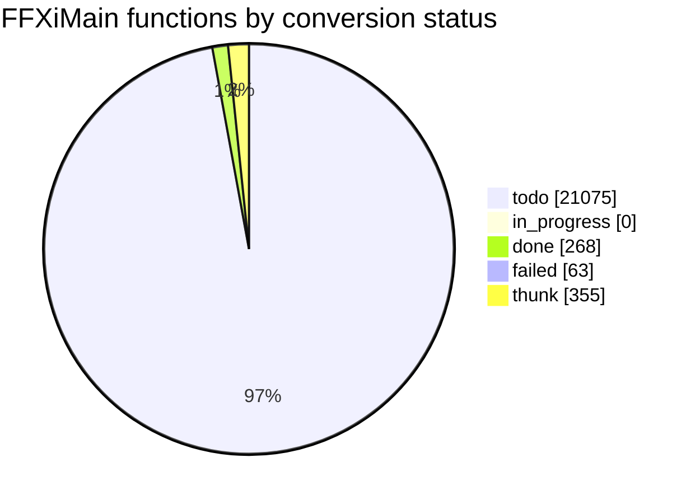

# Conversion status

<!-- Generated by tools/cow/status.py - do not edit by hand. Rerun: python tools/cow/status.py -->

- Last updated: 2026-11-04 01:45:02 UTC
- Commit being made: cow: 0x10299920 cow_return_at_10299920 [placeholder]
- Repo: `14afffb` on `main`, 8 uncommitted change(s) excluding this file's own outputs
- Inputs: ledger 21761 rows · names 360 · loop.log 340 event(s) · unreached 0 unit(s)

## Progress

`done 268 of 21406 (1.3%) [----------------------------]`

_Thunks (355) are excluded from the denominator: 5-byte `jmp rel32` stubs, not work._

## Status counts

## Progress by leaf_rank

Conversion runs leaves first: rank 0 calls no other FFXiMain function.

| leaf_rank | done | total | % |
| --- | --- | --- | --- |
| * **0** | 268 | 7455 | 3.6% |
| 1 | 0 | 2738 | 0.0% |
| 2 | 0 | 1353 | 0.0% |
| 3+ | 0 | 9860 | 0.0% |
| cycle | 0 | 118 | 0.0% |

_`cycle` is an overlay: a function in a call cycle also sits in one rank bucket._

## Last completed

| entry | name | file | verified | oracle evidence |
| --- | --- | --- | --- | --- |
| `0x10299920` | cow_return_at_10299920 | src/unsorted/cow_10299920_ret.c | true | called from 1 code site(s): 0x102998f8 |
| `0x10298fb0` | cow_return_at_10298fb0 | src/unsorted/cow_10298fb0_ret.c | true | called from 1 code site(s): 0x10298f08 |
| `0x10295f40` | cow_return_at_10295f40 | src/unsorted/cow_10295f40_ret.c | true | called from 1 code site(s): 0x10295f18 |
| `0x10291c70` | cow_return_at_10291c70 | src/unsorted/cow_10291c70_ret.c | true | called from 2 code site(s): 0x1027c512, 0x10291c48 |
| `0x10291480` | cow_return_at_10291480 | src/unsorted/cow_10291480_ret.c | true | called from 2 code site(s): 0x1027c51d, 0x10291458 |
| `0x10291180` | cow_return_at_10291180 | src/unsorted/cow_10291180_ret.c | true | called from 1 code site(s): 0x10291108 |
| `0x10290a20` | cow_return_at_10290a20 | src/unsorted/cow_10290a20_ret.c | true | called from 1 code site(s): 0x10290908 |
| `0x10290450` | cow_return_at_10290450 | src/unsorted/cow_10290450_ret.c | true | called from 2 code site(s): 0x1028fca0, 0x1028fcd8 |
| `0x1028a000` | cow_return_at_1028a000 | src/unsorted/cow_1028a000_ret.c | true | called from 1 code site(s): 0x10289fd8 |
| `0x10284ed0` | cow_return_at_10284ed0 | src/unsorted/cow_10284ed0_ret.c | true | called from 1 code site(s): 0x10284bc9 |
| `0x10283260` | cow_return_at_10283260 | src/unsorted/cow_10283260_ret.c | true | called from 4 code site(s): 0x10280e24, 0x1028142a, 0x102814ef, 0x1028b31b |
| `0x10282650` | cow_return_at_10282650 | src/unsorted/cow_10282650_ret.c | true | called from 1 code site(s): 0x10250268 |
| `0x10281a80` | cow_return_at_10281a80 | src/unsorted/cow_10281a80_ret.c | true | called from 2 code site(s): 0x102700ba, 0x102700ca |
| `0x10273e00` | cow_return_at_10273e00 | src/unsorted/cow_10273e00_ret.c | true | called from 1 code site(s): 0x10273e18 |
| `0x10272bc0` | cow_return_at_10272bc0 | src/unsorted/cow_10272bc0_ret.c | true | called from 1 code site(s): 0x10270d30 |
| `0x102720c0` | cow_return_at_102720c0 | src/unsorted/cow_102720c0_ret.c | true | called from 1 code site(s): 0x10270eb3 |
| `0x1026e360` | cow_return_at_1026e360 | src/unsorted/cow_1026e360_ret.c | true | called from 1 code site(s): 0x1026e2e8 |
| `0x1026dfe0` | cow_return_at_1026dfe0 | src/unsorted/cow_1026dfe0_ret.c | true | called from 1 code site(s): 0x1026dfb8 |
| `0x10265650` | cow_vf59_at_10340820 | src/unsorted/cow_10265650_ret.c | true | vtable 0x10340820 slot 59/61 - a virtual method |
| `0x102603a0` | cow_vf39_at_10340428 | src/unsorted/cow_102603a0_ret.c | true | vtable 0x10340428 slot 39/79 - a virtual method |

### The last five, as source

Read them; they are the standard every unit is held to.

- `0x10299920` -> [cow_return_at_10299920](../../src/unsorted/cow_10299920_ret.c)
- `0x10298fb0` -> [cow_return_at_10298fb0](../../src/unsorted/cow_10298fb0_ret.c)
- `0x10295f40` -> [cow_return_at_10295f40](../../src/unsorted/cow_10295f40_ret.c)
- `0x10291c70` -> [cow_return_at_10291c70](../../src/unsorted/cow_10291c70_ret.c)
- `0x10291480` -> [cow_return_at_10291480](../../src/unsorted/cow_10291480_ret.c)

## Failed units

| entry | name | reason |
| --- | --- | --- |
| `0x100fc640` | - | unbooked: no vtable slot and no caller - a stub, not read |
| `0x100fc660` | - | unbooked: no vtable slot and no caller - a stub, not read |
| `0x10107060` | - | unbooked: no vtable slot and no caller - a stub, not read |
| `0x10108580` | - | unbooked: no vtable slot and no caller - a stub, not read |
| `0x101152b0` | - | unbooked: no vtable slot and no caller - a stub, not read |
| `0x101152c0` | - | unbooked: no vtable slot and no caller - a stub, not read |
| `0x101170c0` | - | unbooked: no vtable slot and no caller - a stub, not read |
| `0x101252e0` | - | unbooked: no vtable slot and no caller - a stub, not read |
| `0x1012a8b0` | - | unbooked: no vtable slot and no caller - a stub, not read |
| `0x1012aa20` | - | unbooked: no vtable slot and no caller - a stub, not read |
| `0x1012db70` | - | unbooked: no vtable slot and no caller - a stub, not read |
| `0x1012db80` | - | unbooked: no vtable slot and no caller - a stub, not read |
| `0x10137830` | - | unbooked: no vtable slot and no caller - a stub, not read |
| `0x10138fc0` | - | unbooked: no vtable slot and no caller - a stub, not read |
| `0x1013e740` | - | unbooked: no vtable slot and no caller - a stub, not read |
| `0x10142260` | - | unbooked: no vtable slot and no caller - a stub, not read |
| `0x1014e630` | - | unbooked: no vtable slot and no caller - a stub, not read |
| `0x1014e640` | - | unbooked: no vtable slot and no caller - a stub, not read |
| `0x10151330` | - | unbooked: no vtable slot and no caller - a stub, not read |
| `0x10151df0` | - | unbooked: no vtable slot and no caller - a stub, not read |
| `0x10152650` | - | unbooked: no vtable slot and no caller - a stub, not read |
| `0x10153120` | - | unbooked: no vtable slot and no caller - a stub, not read |
| `0x1015d9d0` | - | unbooked: no vtable slot and no caller - a stub, not read |
| `0x1015df10` | - | unbooked: no vtable slot and no caller - a stub, not read |
| `0x1017c810` | - | unbooked: no vtable slot and no caller - a stub, not read |
| `0x10181a40` | - | unbooked: no vtable slot and no caller - a stub, not read |
| `0x1018b120` | - | unbooked: no vtable slot and no caller - a stub, not read |
| `0x1018c5e0` | - | unbooked: no vtable slot and no caller - a stub, not read |
| `0x1019acf0` | - | unbooked: no vtable slot and no caller - a stub, not read |
| `0x101abbc0` | - | unbooked: no vtable slot and no caller - a stub, not read |
| `0x101b5a70` | - | unbooked: no vtable slot and no caller - a stub, not read |
| `0x10211eb0` | - | unproven: no vtable slot and no call/jmp/push reaches it - a stub, not read |
| `0x10211ef0` | - | unproven: no vtable slot and no call/jmp/push reaches it - a stub, not read |
| `0x10212040` | - | unproven: no vtable slot and no call/jmp/push reaches it - a stub, not read |
| `0x10212a90` | - | unproven: no vtable slot and no call/jmp/push reaches it - a stub, not read |
| `0x1021ad40` | - | unproven: no vtable slot and no call/jmp/push reaches it - a stub, not read |
| `0x102281b0` | - | unproven: no vtable slot and no call/jmp/push reaches it - a stub, not read |
| `0x10229550` | - | unproven: no vtable slot and no call/jmp/push reaches it - a stub, not read |
| `0x102302d0` | - | unproven: no vtable slot and no call/jmp/push reaches it - a stub, not read |
| `0x102421d0` | - | unproven: no vtable slot and no call/jmp/push reaches it - a stub, not read |
| `0x10245610` | - | unproven: no vtable slot and no call/jmp/push reaches it - a stub, not read |
| `0x10253700` | - | unproven: no vtable slot and no call/jmp/push reaches it - a stub, not read |
| `0x10253710` | - | unproven: no vtable slot and no call/jmp/push reaches it - a stub, not read |
| `0x10257550` | - | unproven: no vtable slot and no call/jmp/push reaches it - a stub, not read |
| `0x10257560` | - | unproven: no vtable slot and no call/jmp/push reaches it - a stub, not read |
| `0x10257e20` | - | unproven: no vtable slot and no call/jmp/push reaches it - a stub, not read |
| `0x1025e050` | - | unproven: no vtable slot and no call/jmp/push reaches it - a stub, not read |
| `0x1026e740` | - | unproven: no vtable slot and no call/jmp/push reaches it - a stub, not read |
| `0x1026fbb0` | - | unproven: no vtable slot and no call/jmp/push reaches it - a stub, not read |
| `0x1026fbc0` | - | unproven: no vtable slot and no call/jmp/push reaches it - a stub, not read |
| `0x102751d0` | - | unproven: no vtable slot and no call/jmp/push reaches it - a stub, not read |
| `0x102751e0` | - | unproven: no vtable slot and no call/jmp/push reaches it - a stub, not read |
| `0x1027dd80` | - | unproven: no vtable slot and no call/jmp/push reaches it - a stub, not read |
| `0x10282590` | - | unproven: no vtable slot and no call/jmp/push reaches it - a stub, not read |
| `0x10282920` | - | unproven: no vtable slot and no call/jmp/push reaches it - a stub, not read |
| `0x10282a40` | - | unproven: no vtable slot and no call/jmp/push reaches it - a stub, not read |
| `0x10282cc0` | - | unproven: no vtable slot and no call/jmp/push reaches it - a stub, not read |
| `0x10283b60` | - | unproven: no vtable slot and no call/jmp/push reaches it - a stub, not read |
| `0x10283f60` | - | unproven: no vtable slot and no call/jmp/push reaches it - a stub, not read |
| `0x10284f00` | - | unproven: no vtable slot and no call/jmp/push reaches it - a stub, not read |
| `0x1028a0c0` | - | unproven: no vtable slot and no call/jmp/push reaches it - a stub, not read |
| `0x1028bd20` | - | unproven: no vtable slot and no call/jmp/push reaches it - a stub, not read |
| `0x1028d750` | - | unproven: no vtable slot and no call/jmp/push reaches it - a stub, not read |

## Units with unreached blocks

_Every converted unit reached 100% of its generated basic blocks, or has no cowdiff yet._

## Names by confidence

| confidence | count |
| --- | --- |
| confirmed | 5 |
| guess | 25 |
| placeholder | 330 |

_The fix-up list is [docs/cow/NAMES_TODO.md](NAMES_TODO.md)._
