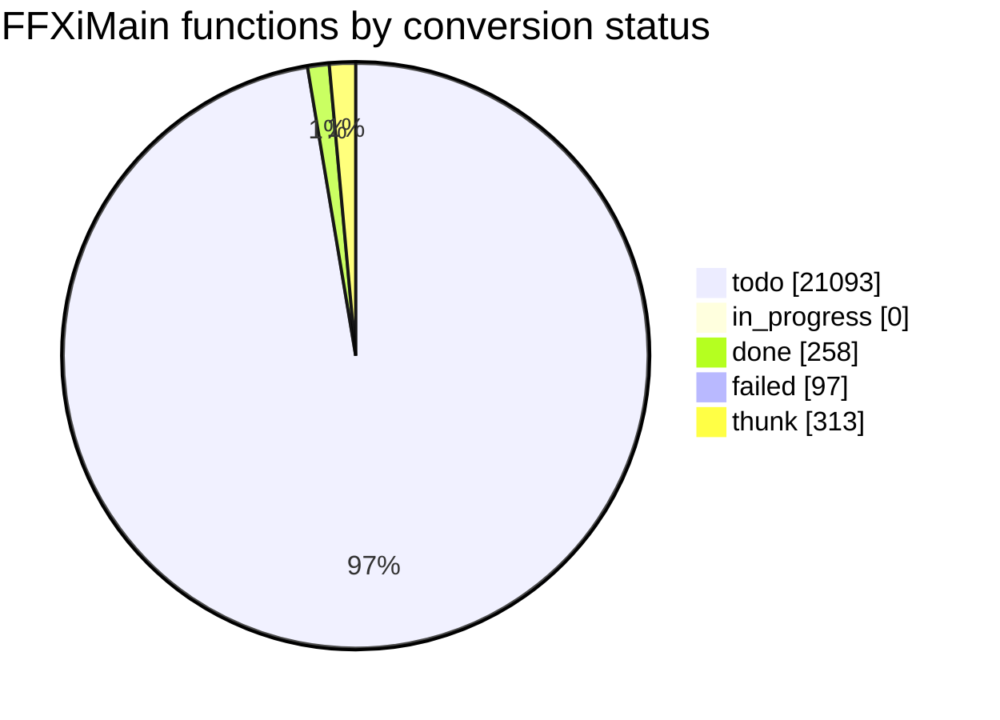

# Conversion status

<!-- Generated by tools/cow/status.py - do not edit by hand. Rerun: python tools/cow/status.py -->

- Last updated: 2026-11-04 01:29:54 UTC
- Commit being made: cow: 0x10283260 cow_return_at_10283260 [placeholder]
- Repo: `d1a2aab` on `main`, 8 uncommitted change(s) excluding this file's own outputs
- Inputs: ledger 21761 rows · names 350 · loop.log 330 event(s) · unreached 0 unit(s)

## Progress

`done 258 of 21448 (1.2%) [----------------------------]`

_Thunks (313) are excluded from the denominator: 5-byte `jmp rel32` stubs, not work._

## Status counts

## Progress by leaf_rank

Conversion runs leaves first: rank 0 calls no other FFXiMain function.

| leaf_rank | done | total | % |
| --- | --- | --- | --- |
| * **0** | 258 | 7497 | 3.4% |
| 1 | 0 | 2738 | 0.0% |
| 2 | 0 | 1353 | 0.0% |
| 3+ | 0 | 9860 | 0.0% |
| cycle | 0 | 118 | 0.0% |

_`cycle` is an overlay: a function in a call cycle also sits in one rank bucket._

## Last completed

| entry | name | file | verified | oracle evidence |
| --- | --- | --- | --- | --- |
| `0x10283260` | cow_return_at_10283260 | src/unsorted/cow_10283260_ret.c | true | called from 4 code site(s): 0x10280e24, 0x1028142a, 0x102814ef, 0x1028b31b |
| `0x10282650` | cow_return_at_10282650 | src/unsorted/cow_10282650_ret.c | true | called from 1 code site(s): 0x10250268 |
| `0x10281a80` | cow_return_at_10281a80 | src/unsorted/cow_10281a80_ret.c | true | called from 2 code site(s): 0x102700ba, 0x102700ca |
| `0x10273e00` | cow_return_at_10273e00 | src/unsorted/cow_10273e00_ret.c | true | called from 1 code site(s): 0x10273e18 |
| `0x10272bc0` | cow_return_at_10272bc0 | src/unsorted/cow_10272bc0_ret.c | true | called from 1 code site(s): 0x10270d30 |
| `0x102720c0` | cow_return_at_102720c0 | src/unsorted/cow_102720c0_ret.c | true | called from 1 code site(s): 0x10270eb3 |
| `0x1026e360` | cow_return_at_1026e360 | src/unsorted/cow_1026e360_ret.c | true | called from 1 code site(s): 0x1026e2e8 |
| `0x1026dfe0` | cow_return_at_1026dfe0 | src/unsorted/cow_1026dfe0_ret.c | true | called from 1 code site(s): 0x1026dfb8 |
| `0x10265650` | cow_vf59_at_10340820 | src/unsorted/cow_10265650_ret.c | true | vtable 0x10340820 slot 59/61 - a virtual method |
| `0x102603a0` | cow_vf39_at_10340428 | src/unsorted/cow_102603a0_ret.c | true | vtable 0x10340428 slot 39/79 - a virtual method |
| `0x10260390` | cow_vf38_at_10340428 | src/unsorted/cow_10260390_ret.c | true | vtable 0x10340428 slot 38/79 - a virtual method |
| `0x1025ff60` | cow_vf19_at_10340678 | src/unsorted/cow_1025ff60_ret.c | true | vtable 0x10340678 slot 19/105 - a virtual method |
| `0x1025ff50` | cow_vf18_at_10340678 | src/unsorted/cow_1025ff50_ret.c | true | vtable 0x10340678 slot 18/105 - a virtual method |
| `0x1025e0f0` | cow_return_at_1025e0f0 | src/unsorted/cow_1025e0f0_ret.c | true | called from 1 code site(s): 0x10010935 |
| `0x102572f0` | cow_return_at_102572f0 | src/unsorted/cow_102572f0_ret.c | true | called from 8 code site(s): 0x102572e0, 0x10257ff0, 0x1025c7a0, 0x1025caa0 |
| `0x10253350` | cow_return_at_10253350 | src/unsorted/cow_10253350_ret.c | true | called from 1 code site(s): 0x10253309 |
| `0x10251510` | cow_return_at_10251510 | src/unsorted/cow_10251510_ret.c | true | called from 1 code site(s): 0x10167146 |
| `0x102514d0` | cow_return_at_102514d0 | src/unsorted/cow_102514d0_ret.c | true | called from 1 code site(s): 0x102514c0 |
| `0x1024b770` | cow_vf14_at_10388c18 | src/unsorted/cow_1024b770_ret.c | true | vtable 0x10388c18 slot 14/15 - a virtual method |
| `0x102450d0` | cow_vf4_at_10335ca0 | src/unsorted/cow_102450d0_ret.c | true | vtable 0x10335ca0 slot 4/17 - a virtual method |

### The last five, as source

Read them; they are the standard every unit is held to.

- `0x10283260` -> [cow_return_at_10283260](../../src/unsorted/cow_10283260_ret.c)
- `0x10282650` -> [cow_return_at_10282650](../../src/unsorted/cow_10282650_ret.c)
- `0x10281a80` -> [cow_return_at_10281a80](../../src/unsorted/cow_10281a80_ret.c)
- `0x10273e00` -> [cow_return_at_10273e00](../../src/unsorted/cow_10273e00_ret.c)
- `0x10272bc0` -> [cow_return_at_10272bc0](../../src/unsorted/cow_10272bc0_ret.c)

## Failed units

| entry | name | reason |
| --- | --- | --- |
| `0x100139d0` | - | still unproven: no vtable slot, no caller, no data word |
| `0x100152e0` | - | still unproven: no vtable slot, no caller, no data word |
| `0x10015320` | - | still unproven: no vtable slot, no caller, no data word |
| `0x10017d60` | - | still unproven: no vtable slot, no caller, no data word |
| `0x10017d70` | - | still unproven: no vtable slot, no caller, no data word |
| `0x10017d80` | - | still unproven: no vtable slot, no caller, no data word |
| `0x10018510` | - | still unproven: no vtable slot, no caller, no data word |
| `0x10018520` | - | still unproven: no vtable slot, no caller, no data word |
| `0x10018530` | - | unbooked: no vtable slot and no caller - a stub, not read |
| `0x10018540` | - | unbooked: no vtable slot and no caller - a stub, not read |
| `0x10025ba0` | - | unbooked: no vtable slot and no caller - a stub, not read |
| `0x10026240` | - | unbooked: no vtable slot and no caller - a stub, not read |
| `0x100293d0` | - | unbooked: no vtable slot and no caller - a stub, not read |
| `0x100371b0` | - | unbooked: no vtable slot and no caller - a stub, not read |
| `0x10037a00` | - | unbooked: no vtable slot and no caller - a stub, not read |
| `0x10037a90` | - | unbooked: no vtable slot and no caller - a stub, not read |
| `0x10037aa0` | - | unbooked: no vtable slot and no caller - a stub, not read |
| `0x1003d990` | - | unbooked: no vtable slot and no caller - a stub, not read |
| `0x10040210` | - | unbooked: no vtable slot and no caller - a stub, not read |
| `0x10042510` | - | unbooked: no vtable slot and no caller - a stub, not read |
| `0x10044690` | - | unbooked: no vtable slot and no caller - a stub, not read |
| `0x10046530` | - | unbooked: no vtable slot and no caller - a stub, not read |
| `0x10046540` | - | unbooked: no vtable slot and no caller - a stub, not read |
| `0x10054420` | - | unbooked: no vtable slot and no caller - a stub, not read |
| `0x100554a0` | - | unbooked: no vtable slot and no caller - a stub, not read |
| `0x10056280` | - | unbooked: no vtable slot and no caller - a stub, not read |
| `0x10062f40` | - | unbooked: no vtable slot and no caller - a stub, not read |
| `0x1006ad80` | - | unbooked: no vtable slot and no caller - a stub, not read |
| `0x10072c80` | - | unbooked: no vtable slot and no caller - a stub, not read |
| `0x10084190` | - | unbooked: no vtable slot and no caller - a stub, not read |
| `0x10087470` | - | unbooked: no vtable slot and no caller - a stub, not read |
| `0x100a33d0` | - | unbooked: no vtable slot and no caller - a stub, not read |
| `0x100a33e0` | - | unbooked: no vtable slot and no caller - a stub, not read |
| `0x100a41c0` | - | unbooked: no vtable slot and no caller - a stub, not read |
| `0x100a9f30` | - | unbooked: no vtable slot and no caller - a stub, not read |
| `0x100ad940` | - | unbooked: no vtable slot and no caller - a stub, not read |
| `0x100bd190` | - | unbooked: no vtable slot and no caller - a stub, not read |
| `0x100c2e10` | - | unbooked: no vtable slot and no caller - a stub, not read |
| `0x100d6f80` | - | unbooked: no vtable slot and no caller - a stub, not read |
| `0x100f7780` | - | unbooked: no vtable slot and no caller - a stub, not read |
| `0x100fc640` | - | unbooked: no vtable slot and no caller - a stub, not read |
| `0x100fc660` | - | unbooked: no vtable slot and no caller - a stub, not read |
| `0x10107060` | - | unbooked: no vtable slot and no caller - a stub, not read |
| `0x10108580` | - | unbooked: no vtable slot and no caller - a stub, not read |
| `0x101152b0` | - | unbooked: no vtable slot and no caller - a stub, not read |
| `0x101152c0` | - | unbooked: no vtable slot and no caller - a stub, not read |
| `0x101170c0` | - | unbooked: no vtable slot and no caller - a stub, not read |
| `0x101252e0` | - | unbooked: no vtable slot and no caller - a stub, not read |
| `0x1012a8b0` | - | unbooked: no vtable slot and no caller - a stub, not read |
| `0x1012aa20` | - | unbooked: no vtable slot and no caller - a stub, not read |
| `0x1012db70` | - | unbooked: no vtable slot and no caller - a stub, not read |
| `0x1012db80` | - | unbooked: no vtable slot and no caller - a stub, not read |
| `0x10137830` | - | unbooked: no vtable slot and no caller - a stub, not read |
| `0x10138fc0` | - | unbooked: no vtable slot and no caller - a stub, not read |
| `0x1013e740` | - | unbooked: no vtable slot and no caller - a stub, not read |
| `0x10142260` | - | unbooked: no vtable slot and no caller - a stub, not read |
| `0x1014e630` | - | unbooked: no vtable slot and no caller - a stub, not read |
| `0x1014e640` | - | unbooked: no vtable slot and no caller - a stub, not read |
| `0x10151330` | - | unbooked: no vtable slot and no caller - a stub, not read |
| `0x10151df0` | - | unbooked: no vtable slot and no caller - a stub, not read |
| `0x10152650` | - | unbooked: no vtable slot and no caller - a stub, not read |
| `0x10153120` | - | unbooked: no vtable slot and no caller - a stub, not read |
| `0x1015d9d0` | - | unbooked: no vtable slot and no caller - a stub, not read |
| `0x1015df10` | - | unbooked: no vtable slot and no caller - a stub, not read |
| `0x1017c810` | - | unbooked: no vtable slot and no caller - a stub, not read |
| `0x10181a40` | - | unbooked: no vtable slot and no caller - a stub, not read |
| `0x1018b120` | - | unbooked: no vtable slot and no caller - a stub, not read |
| `0x1018c5e0` | - | unbooked: no vtable slot and no caller - a stub, not read |
| `0x1019acf0` | - | unbooked: no vtable slot and no caller - a stub, not read |
| `0x101abbc0` | - | unbooked: no vtable slot and no caller - a stub, not read |
| `0x101b5a70` | - | unbooked: no vtable slot and no caller - a stub, not read |
| `0x10211eb0` | - | unproven: no vtable slot and no call/jmp/push reaches it - a stub, not read |
| `0x10211ef0` | - | unproven: no vtable slot and no call/jmp/push reaches it - a stub, not read |
| `0x10212040` | - | unproven: no vtable slot and no call/jmp/push reaches it - a stub, not read |
| `0x10212a90` | - | unproven: no vtable slot and no call/jmp/push reaches it - a stub, not read |
| `0x1021ad40` | - | unproven: no vtable slot and no call/jmp/push reaches it - a stub, not read |
| `0x102281b0` | - | unproven: no vtable slot and no call/jmp/push reaches it - a stub, not read |
| `0x10229550` | - | unproven: no vtable slot and no call/jmp/push reaches it - a stub, not read |
| `0x102302d0` | - | unproven: no vtable slot and no call/jmp/push reaches it - a stub, not read |
| `0x102421d0` | - | unproven: no vtable slot and no call/jmp/push reaches it - a stub, not read |
| `0x10245610` | - | unproven: no vtable slot and no call/jmp/push reaches it - a stub, not read |
| `0x10253700` | - | unproven: no vtable slot and no call/jmp/push reaches it - a stub, not read |
| `0x10253710` | - | unproven: no vtable slot and no call/jmp/push reaches it - a stub, not read |
| `0x10257550` | - | unproven: no vtable slot and no call/jmp/push reaches it - a stub, not read |
| `0x10257560` | - | unproven: no vtable slot and no call/jmp/push reaches it - a stub, not read |
| `0x10257e20` | - | unproven: no vtable slot and no call/jmp/push reaches it - a stub, not read |
| `0x1025e050` | - | unproven: no vtable slot and no call/jmp/push reaches it - a stub, not read |
| `0x1026e740` | - | unproven: no vtable slot and no call/jmp/push reaches it - a stub, not read |
| `0x1026fbb0` | - | unproven: no vtable slot and no call/jmp/push reaches it - a stub, not read |
| `0x1026fbc0` | - | unproven: no vtable slot and no call/jmp/push reaches it - a stub, not read |
| `0x102751d0` | - | unproven: no vtable slot and no call/jmp/push reaches it - a stub, not read |
| `0x102751e0` | - | unproven: no vtable slot and no call/jmp/push reaches it - a stub, not read |
| `0x1027dd80` | - | unproven: no vtable slot and no call/jmp/push reaches it - a stub, not read |
| `0x10282590` | - | unproven: no vtable slot and no call/jmp/push reaches it - a stub, not read |
| `0x10282920` | - | unproven: no vtable slot and no call/jmp/push reaches it - a stub, not read |
| `0x10282a40` | - | unproven: no vtable slot and no call/jmp/push reaches it - a stub, not read |
| `0x10282cc0` | - | unproven: no vtable slot and no call/jmp/push reaches it - a stub, not read |

## Units with unreached blocks

_Every converted unit reached 100% of its generated basic blocks, or has no cowdiff yet._

## Names by confidence

| confidence | count |
| --- | --- |
| confirmed | 5 |
| guess | 25 |
| placeholder | 320 |

_The fix-up list is [docs/cow/NAMES_TODO.md](NAMES_TODO.md)._
