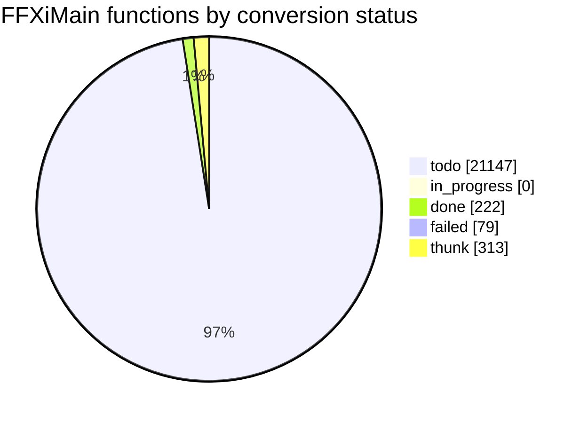

# Conversion status

<!-- Generated by tools/cow/status.py - do not edit by hand. Rerun: python tools/cow/status.py -->

- Last updated: 2026-11-03 17:59:22 UTC
- Commit being made: cow: 0x10237590 cow_vf4_at_10335bc8 [placeholder]
- Repo: `2dd5360` on `main`, 9 uncommitted change(s) excluding this file's own outputs
- Inputs: ledger 21761 rows · names 314 · loop.log 294 event(s) · unreached 0 unit(s)

## Progress

`done 222 of 21448 (1.0%) [----------------------------]`

_Thunks (313) are excluded from the denominator: 5-byte `jmp rel32` stubs, not work._

## Status counts

## Progress by leaf_rank

Conversion runs leaves first: rank 0 calls no other FFXiMain function.

| leaf_rank | done | total | % |
| --- | --- | --- | --- |
| * **0** | 222 | 7497 | 3.0% |
| 1 | 0 | 2738 | 0.0% |
| 2 | 0 | 1353 | 0.0% |
| 3+ | 0 | 9860 | 0.0% |
| cycle | 0 | 118 | 0.0% |

_`cycle` is an overlay: a function in a call cycle also sits in one rank bucket._

## Last completed

| entry | name | file | verified | oracle evidence |
| --- | --- | --- | --- | --- |
| `0x10237590` | cow_vf4_at_10335bc8 | src/unsorted/cow_10237590_ret.c | true | vtable 0x10335bc8 slot 4/17 - a virtual method |
| `0x10228be0` | cow_menu_vf1 | src/unsorted/cow_10228be0_ret.c | true | vtable 0x1033c298 slot 1/17 - a virtual method;vtable named menu from the vocabulary its slots cite: menu x1,  |
| `0x10228b50` | cow_return_at_10228b50 | src/unsorted/cow_10228b50_ret.c | true | called from 1 code site(s): 0x10228bd8 |
| `0x10222e00` | cow_return_at_10222e00 | src/unsorted/cow_10222e00_ret.c | true | called from 1 code site(s): 0x1009e5fb |
| `0x10221860` | cow_vf43_at_1033c068 | src/unsorted/cow_10221860_ret.c | true | vtable 0x1033c068 slot 43/96 - a virtual method |
| `0x10221830` | cow_vf22_at_1033c648 | src/unsorted/cow_10221830_ret.c | true | vtable 0x1033c648 slot 22/53 - a virtual method |
| `0x10221820` | cow_vf39_at_1033c068 | src/unsorted/cow_10221820_ret.c | true | vtable 0x1033c068 slot 39/96 - a virtual method |
| `0x10221800` | cow_vf63_at_1033c068 | src/unsorted/cow_10221800_ret.c | true | vtable 0x1033c068 slot 63/96 - a virtual method |
| `0x1021df30` | cow_vf20_at_10340678 | src/unsorted/cow_1021df30_ret.c | true | vtable 0x10340678 slot 20/105 - a virtual method |
| `0x1021ddc0` | cow_return_at_1021ddc0 | src/unsorted/cow_1021ddc0_ret.c | true | called from 1 code site(s): 0x1021d9a0 |
| `0x1021d260` | cow_return_at_1021d260 | src/unsorted/cow_1021d260_ret.c | true | called from 1 code site(s): 0x1021c05d |
| `0x10217d10` | cow_anc_s_vf15 | src/unsorted/cow_10217d10_ret.c | true | vtable 0x1033bd58 slot 15/20 - a virtual method;vtable named anc_s from the vocabulary its slots cite: anc_s x |
| `0x102167c0` | cow_anc_s_vf15 | src/unsorted/cow_102167c0_ret.c | true | vtable 0x1033bcf8 slot 15/17 - a virtual method;vtable named anc_s from the vocabulary its slots cite: anc_s x |
| `0x10206c40` | cow_menu_vf13 | src/unsorted/cow_10206c40_ret.c | true | vtable 0x10338098 slot 13/17 - a virtual method;vtable named menu from the vocabulary its slots cite: menu x1, |
| `0x10206c30` | cow_menu_vf13 | src/unsorted/cow_10206c30_ret.c | true | vtable 0x103380e0 slot 13/17 - a virtual method;vtable named menu from the vocabulary its slots cite: menu x1, |
| `0x10206c20` | cow_vf13_at_10338128 | src/unsorted/cow_10206c20_ret.c | true | vtable 0x10338128 slot 13/17 - a virtual method |
| `0x10206c10` | cow_vf13_at_10338170 | src/unsorted/cow_10206c10_ret.c | true | vtable 0x10338170 slot 13/17 - a virtual method |
| `0x10206c00` | cow_vf13_at_103381b8 | src/unsorted/cow_10206c00_ret.c | true | vtable 0x103381b8 slot 13/17 - a virtual method |
| `0x10206bf0` | cow_menu_vf13 | src/unsorted/cow_10206bf0_ret.c | true | vtable 0x10338200 slot 13/17 - a virtual method;vtable named menu from the vocabulary its slots cite: menu x1, |
| `0x10206be0` | cow_menu_vf2 | src/unsorted/cow_10206be0_ret.c | true | vtable 0x10338098 slot 2/17 - a virtual method;vtable named menu from the vocabulary its slots cite: menu x1,  |

### The last five, as source

Read them; they are the standard every unit is held to.

- `0x10237590` -> [cow_vf4_at_10335bc8](../../src/unsorted/cow_10237590_ret.c)
- `0x10228be0` -> [cow_menu_vf1](../../src/unsorted/cow_10228be0_ret.c)
- `0x10228b50` -> [cow_return_at_10228b50](../../src/unsorted/cow_10228b50_ret.c)
- `0x10222e00` -> [cow_return_at_10222e00](../../src/unsorted/cow_10222e00_ret.c)
- `0x10221860` -> [cow_vf43_at_1033c068](../../src/unsorted/cow_10221860_ret.c)

## Failed units

| entry | name | reason |
| --- | --- | --- |
| `0x100139d0` | - | still unproven: no vtable slot, no caller, no data word |
| `0x100152e0` | - | still unproven: no vtable slot, no caller, no data word |
| `0x10015320` | - | still unproven: no vtable slot, no caller, no data word |
| `0x10017d60` | - | still unproven: no vtable slot, no caller, no data word |
| `0x10017d70` | - | still unproven: no vtable slot, no caller, no data word |
| `0x10017d80` | - | still unproven: no vtable slot, no caller, no data word |
| `0x10018510` | - | still unproven: no vtable slot, no caller, no data word |
| `0x10018520` | - | still unproven: no vtable slot, no caller, no data word |
| `0x10018530` | - | unbooked: no vtable slot and no caller - a stub, not read |
| `0x10018540` | - | unbooked: no vtable slot and no caller - a stub, not read |
| `0x10025ba0` | - | unbooked: no vtable slot and no caller - a stub, not read |
| `0x10026240` | - | unbooked: no vtable slot and no caller - a stub, not read |
| `0x100293d0` | - | unbooked: no vtable slot and no caller - a stub, not read |
| `0x100371b0` | - | unbooked: no vtable slot and no caller - a stub, not read |
| `0x10037a00` | - | unbooked: no vtable slot and no caller - a stub, not read |
| `0x10037a90` | - | unbooked: no vtable slot and no caller - a stub, not read |
| `0x10037aa0` | - | unbooked: no vtable slot and no caller - a stub, not read |
| `0x1003d990` | - | unbooked: no vtable slot and no caller - a stub, not read |
| `0x10040210` | - | unbooked: no vtable slot and no caller - a stub, not read |
| `0x10042510` | - | unbooked: no vtable slot and no caller - a stub, not read |
| `0x10044690` | - | unbooked: no vtable slot and no caller - a stub, not read |
| `0x10046530` | - | unbooked: no vtable slot and no caller - a stub, not read |
| `0x10046540` | - | unbooked: no vtable slot and no caller - a stub, not read |
| `0x10054420` | - | unbooked: no vtable slot and no caller - a stub, not read |
| `0x100554a0` | - | unbooked: no vtable slot and no caller - a stub, not read |
| `0x10056280` | - | unbooked: no vtable slot and no caller - a stub, not read |
| `0x10062f40` | - | unbooked: no vtable slot and no caller - a stub, not read |
| `0x1006ad80` | - | unbooked: no vtable slot and no caller - a stub, not read |
| `0x10072c80` | - | unbooked: no vtable slot and no caller - a stub, not read |
| `0x10084190` | - | unbooked: no vtable slot and no caller - a stub, not read |
| `0x10087470` | - | unbooked: no vtable slot and no caller - a stub, not read |
| `0x100a33d0` | - | unbooked: no vtable slot and no caller - a stub, not read |
| `0x100a33e0` | - | unbooked: no vtable slot and no caller - a stub, not read |
| `0x100a41c0` | - | unbooked: no vtable slot and no caller - a stub, not read |
| `0x100a9f30` | - | unbooked: no vtable slot and no caller - a stub, not read |
| `0x100ad940` | - | unbooked: no vtable slot and no caller - a stub, not read |
| `0x100bd190` | - | unbooked: no vtable slot and no caller - a stub, not read |
| `0x100c2e10` | - | unbooked: no vtable slot and no caller - a stub, not read |
| `0x100d6f80` | - | unbooked: no vtable slot and no caller - a stub, not read |
| `0x100f7780` | - | unbooked: no vtable slot and no caller - a stub, not read |
| `0x100fc640` | - | unbooked: no vtable slot and no caller - a stub, not read |
| `0x100fc660` | - | unbooked: no vtable slot and no caller - a stub, not read |
| `0x10107060` | - | unbooked: no vtable slot and no caller - a stub, not read |
| `0x10108580` | - | unbooked: no vtable slot and no caller - a stub, not read |
| `0x101152b0` | - | unbooked: no vtable slot and no caller - a stub, not read |
| `0x101152c0` | - | unbooked: no vtable slot and no caller - a stub, not read |
| `0x101170c0` | - | unbooked: no vtable slot and no caller - a stub, not read |
| `0x101252e0` | - | unbooked: no vtable slot and no caller - a stub, not read |
| `0x1012a8b0` | - | unbooked: no vtable slot and no caller - a stub, not read |
| `0x1012aa20` | - | unbooked: no vtable slot and no caller - a stub, not read |
| `0x1012db70` | - | unbooked: no vtable slot and no caller - a stub, not read |
| `0x1012db80` | - | unbooked: no vtable slot and no caller - a stub, not read |
| `0x10137830` | - | unbooked: no vtable slot and no caller - a stub, not read |
| `0x10138fc0` | - | unbooked: no vtable slot and no caller - a stub, not read |
| `0x1013e740` | - | unbooked: no vtable slot and no caller - a stub, not read |
| `0x10142260` | - | unbooked: no vtable slot and no caller - a stub, not read |
| `0x1014e630` | - | unbooked: no vtable slot and no caller - a stub, not read |
| `0x1014e640` | - | unbooked: no vtable slot and no caller - a stub, not read |
| `0x10151330` | - | unbooked: no vtable slot and no caller - a stub, not read |
| `0x10151df0` | - | unbooked: no vtable slot and no caller - a stub, not read |
| `0x10152650` | - | unbooked: no vtable slot and no caller - a stub, not read |
| `0x10153120` | - | unbooked: no vtable slot and no caller - a stub, not read |
| `0x1015d9d0` | - | unbooked: no vtable slot and no caller - a stub, not read |
| `0x1015df10` | - | unbooked: no vtable slot and no caller - a stub, not read |
| `0x1017c810` | - | unbooked: no vtable slot and no caller - a stub, not read |
| `0x10181a40` | - | unbooked: no vtable slot and no caller - a stub, not read |
| `0x1018b120` | - | unbooked: no vtable slot and no caller - a stub, not read |
| `0x1018c5e0` | - | unbooked: no vtable slot and no caller - a stub, not read |
| `0x1019acf0` | - | unbooked: no vtable slot and no caller - a stub, not read |
| `0x101abbc0` | - | unbooked: no vtable slot and no caller - a stub, not read |
| `0x101b5a70` | - | unbooked: no vtable slot and no caller - a stub, not read |
| `0x10211eb0` | - | unproven: no vtable slot and no call/jmp/push reaches it - a stub, not read |
| `0x10211ef0` | - | unproven: no vtable slot and no call/jmp/push reaches it - a stub, not read |
| `0x10212040` | - | unproven: no vtable slot and no call/jmp/push reaches it - a stub, not read |
| `0x10212a90` | - | unproven: no vtable slot and no call/jmp/push reaches it - a stub, not read |
| `0x1021ad40` | - | unproven: no vtable slot and no call/jmp/push reaches it - a stub, not read |
| `0x102281b0` | - | unproven: no vtable slot and no call/jmp/push reaches it - a stub, not read |
| `0x10229550` | - | unproven: no vtable slot and no call/jmp/push reaches it - a stub, not read |
| `0x102302d0` | - | unproven: no vtable slot and no call/jmp/push reaches it - a stub, not read |

## Units with unreached blocks

_Every converted unit reached 100% of its generated basic blocks, or has no cowdiff yet._

## Names by confidence

| confidence | count |
| --- | --- |
| confirmed | 5 |
| guess | 22 |
| placeholder | 287 |

_The fix-up list is [docs/cow/NAMES_TODO.md](NAMES_TODO.md)._
